# Lab 02: Setting Up Multi-Factor Authentication

<p align="center">
  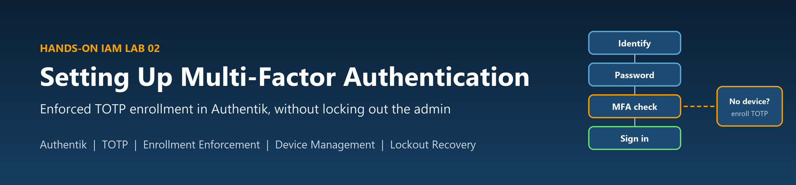
</p>

<p align="center">
  <strong>Professional Lab Documentation | Identity & Access Management / Authentication</strong>
</p>

<p align="center">
  
  
  
  
</p>

---

## Table of Contents

1. [Project Overview](#project-overview)
2. [Objectives](#objectives)
3. [Scenario / Business Context](#scenario-business-context)
4. [Technologies & Tools](#technologies-tools)
5. [Architecture / Workflow](#architecture-workflow)
6. [Implementation / Steps Performed](#implementation-steps)
7. [Key Findings / Results](#key-findings-results)
8. [Skills Demonstrated](#skills-demonstrated)
9. [Screenshots & Evidence](#screenshots-evidence)
10. [Real-World Relevance](#real-world-relevance)
11. [Summary](#summary)
12. [Disclaimer](#disclaimer)

---

<a id="project-overview"></a>

## :pushpin: Project Overview

This lab adds **multi-factor authentication (MFA)** to an **Authentik** identity provider. A password alone is a single secret that can be phished, guessed or reused; a second factor means a stolen password is not enough to sign in. The lab uses **TOTP** (time-based one-time passwords from an authenticator app) because it needs no special hardware.

The key point of the guide is that Authentik already ships the MFA stage, switched off. The lab does not build a new stage: it changes one setting on the existing validation stage so that a user with no authenticator is **forced to enroll one during sign-in**, then checks the login flow, tests enrollment and the ordinary code challenge, and covers device administration and lockout recovery. Three optional scenarios (WebAuthn, conditional MFA by group and backup codes) are documented separately.

**Main objective:** enforce TOTP enrollment for users who have no authenticator, using the stage Authentik already ships, without creating duplicate validation stages and without losing the ability to recover from a lost device.

> **Evidence scope.** This documentation is based on the training guide *Hands-On IAM Labs – Lab 2: Setting Up Multi-Factor Authentication* by **Andrew, All Things Identity** (guide version V11, 34 pages). The guide is written for Authentik 2026.8, and its screenshots were captured on Authentik 2026.8.5 in November 2026. All screenshots are the guide author's example screenshots and are attributed to All Things Identity. Configuration and results below are **source-described**, **source-illustrated** or **expected**; they are **not** evidence that the portfolio owner personally performed the lab, and no test passes, recovery outcomes or metrics are claimed. Enrollment screens and backup-code screens are deliberately excluded (see [Screenshots & Evidence](#screenshots-evidence)).

### Lab Environment (from the source guide)

| Component | Details |
|---|---|
| Identity provider | Authentik, guide written for 2026.8 (screens captured on 2026.8.5) |
| Admin interface | `YOUR_AUTHENTIK_URL/if/admin/` (placeholder; the lab address comes from the learner's Lab Access Email) |
| User interface | `YOUR_AUTHENTIK_URL/if/user/` |
| Transport | Plain HTTP in the lab by design; the guide states production should always use HTTPS |
| Second factor | TOTP in an authenticator app (Google Authenticator, Microsoft Authenticator or Authy); a desktop authenticator such as 1Password is the guide's alternative for learners without a smartphone |

**Prerequisites listed in the guide (p. 1):**

- Authentik set up and accessible (Lab 0)
- The Authentik admin account (`akadmin`) and its password, supplied in the learner's Lab Access Email (not reproduced here)
- At least one test user with a password set by the admin. Accounts created by the Lab 1 sync have no password, so none can sign in until one is set (Step 4)
- An authenticator app on a mobile device, or a desktop alternative

---

<a id="objectives"></a>

## :dart: Objectives

The guide's stated learning objectives (p. 2) are to:

- Configure TOTP MFA using authenticator apps, safe for all learners
- Understand Authentik flows and stages
- Test MFA enrollment and login from a user perspective
- (Optional) Explore WebAuthn and conditional MFA for learners with security keys

The guide also covers device administration and lockout recovery (Part 3).

---

<a id="scenario-business-context"></a>

## :office: Scenario / Business Context

The guide does not describe a specific organization. Its framing is practical: MFA must be switched on in a way that does not lock people out. The guide limits the basic setup to TOTP because most learners do not have security keys, and **requiring WebAuthn in the basic setup causes lockouts** (p. 1).

Three design concerns run through the lab:

| Concern | How the guide addresses it |
|---|---|
| Users without an authenticator | Enrollment is forced inside the sign-in flow, so nobody has to be sent to an enrollment page |
| The shared login flow also gates the admin | The admin must enroll and keep a working authenticator; recovery is done from the admin console |
| Lost devices | An admin deletes the lost device; the user re-enrolls at the next sign-in while the MFA stage still applies |

---

<a id="technologies-tools"></a>

## :hammer_and_wrench: Technologies & Tools

| Technology / Tool | Purpose in this lab |
|---|---|
| **Authentik** Flows and Stages | Hosts the login flow (`default-authentication-flow`) and its stages |
| `default-authentication-mfa-validation` | Existing Authenticator Validation Stage at order 30 in the login flow; the one setting changed in this lab |
| `default-authenticator-totp-setup` | Existing TOTP Authenticator Setup Stage; enrolls a user who has no authenticator |
| `default-authenticator-webauthn-setup` | Existing WebAuthn setup stage (optional scenario 1) |
| `default-authenticator-static-setup` | Existing backup-code (static token) stage (optional scenario 3) |
| **Authentik** Customization > Policies | Expression policy for conditional MFA (optional scenario 2) |
| **Authentik** Directory > Users | Setting the test user's password; viewing and deleting a user's MFA devices |
| Authenticator app | Generates TOTP codes from the secret shared once at enrollment |
| Private / incognito browser window | Test-user session kept separate from the admin session |

---

<a id="architecture-workflow"></a>

## :building_construction: Architecture / Workflow

Both diagrams below are written in Mermaid inside this README, so GitHub draws them directly. To change a label, box or arrow, edit the text in the `mermaid` code block.

### Architecture

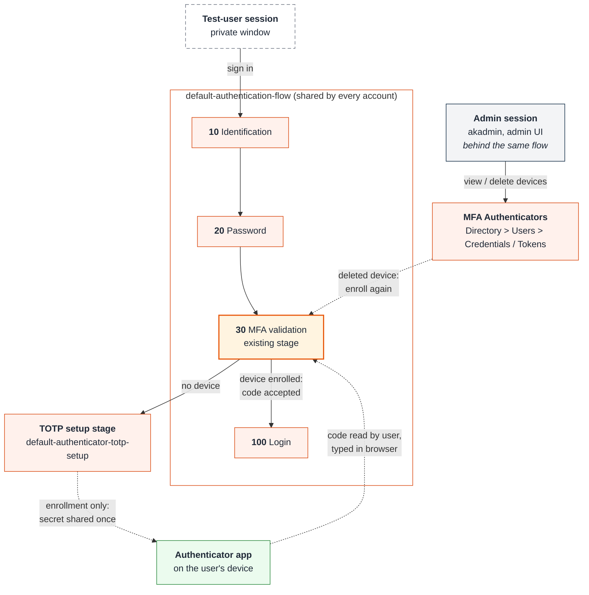

<sub>Image version of this diagram: [`assets/architecture.png`](assets/architecture.png)</sub>

How to read the diagram:

- **Sign-in path (solid arrows):** every account, including `akadmin`, uses the same login flow. The MFA validation stage at order 30 either accepts a code from an enrolled device or, for a user with no device, hands over to the TOTP setup stage.
- **Setup versus validation (dotted arrows):** the TOTP secret is shared with the authenticator app **once, at enrollment**. After that the app derives codes locally from the secret and the current time; the user reads a code and types it into the browser, and Authentik validates it. The app does not contact Authentik at sign-in.
- **Device administration:** an admin can view and delete a user's devices. Deleting a lost device means the next sign-in goes through enrollment again, as long as the validation stage still applies to that user.
- **Recovery dependency:** this recovery is done from the admin console, which is itself behind the same login flow. If the admin's only authenticator is lost, browser-based recovery is not available to that admin.

### Sign-in workflow

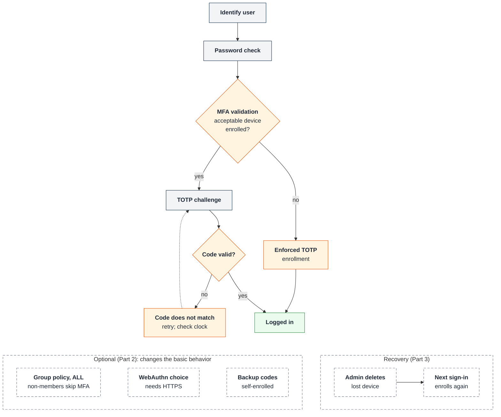

<sub>Image version of this diagram: [`assets/workflow.png`](assets/workflow.png)</sub>

The main path is the basic TOTP-only configuration. The optional scenarios and the recovery procedure are drawn separately because they change who is challenged or how a user gets back in; they are not part of the basic setup.

---

<a id="implementation-steps"></a>

## :gear: Implementation / Steps Performed

The steps below follow the guide's Part 1 (basic TOTP setup), Part 2 (optional configurations) and Part 3 (device management). They describe what the guide instructs and the expected result at each step, not steps performed by the portfolio owner. Screenshot captions summarize the guide's figure captions; the exact original captions are kept in [`docs/evidence-manifest.json`](docs/evidence-manifest.json).

### Part 1, Step 1: Access the admin interface

The learner opens `YOUR_AUTHENTIK_URL/if/admin/` and signs in as `akadmin` with the password from the Lab Access Email (pp. 2–3). The guide notes that the lab runs on HTTP, so no padlock icon is expected. The login and password screens (Figures 2.1 and 2.2) are not reproduced.

### Part 1, Step 2: Switch on the existing MFA stage

Authentik ships a validation stage called **`default-authentication-mfa-validation`** that **already exists** and is **already bound** into the login flow (p. 4). In the guide's starting configuration its *Not configured action* is **Continue**, so a user who has no authenticator is waved through. This step changes that action; **it does not create a new validation stage**.

This does not mean that already-enrolled users could never be challenged before the change: the *Continue* action only governs users who have no authenticator.

In **Flows and Stages > Stages**, the learner edits `default-authentication-mfa-validation` (type *Authenticator Validation Stage*) and sets:

| Setting | Source configuration |
|---|---|
| Not configured action | Force the user to configure an authenticator |
| Configuration stages | `default-authenticator-totp-setup` |
| Device Classes | Leave all six selected, as instructed by this guide |

The six device classes are **Static Tokens, TOTP Authenticators, WebAuthn Authenticators, Duo Authenticators, SMS-based Authenticators and Email-based Authenticators** (pp. 6–7).

<p align="center">
  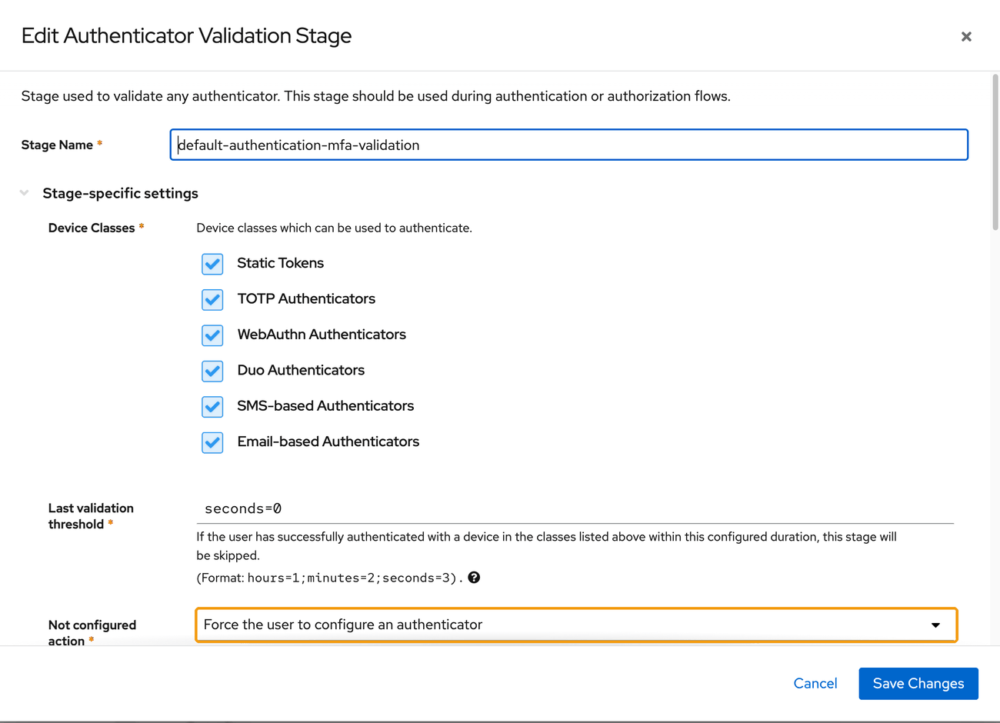
  <br><em>The setting that switches MFA on: users with no authenticator now have to enroll. All six device classes remain ticked. (Source: p. 6, Figure 2.6)</em>
</p>

<p align="center">
  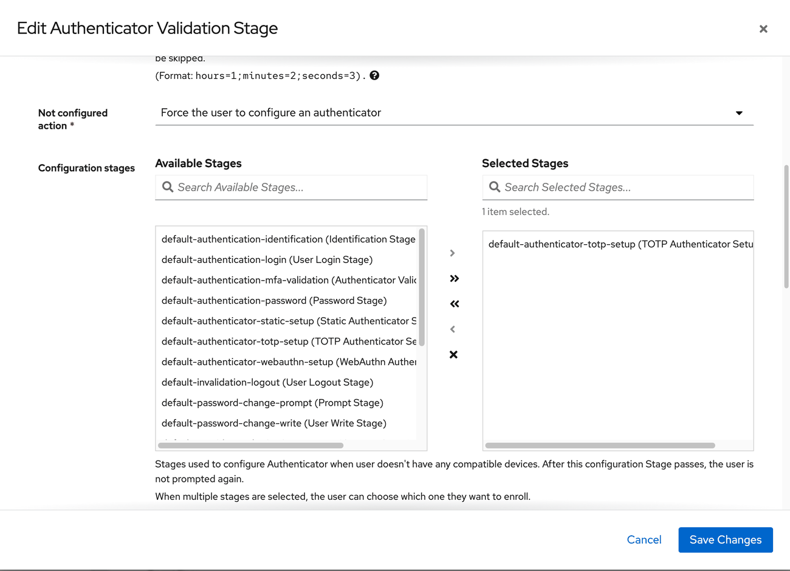
  <br><em>The finished stage: TOTP setup selected as the only configuration stage, force-configure on. (Source: p. 7, Figure 2.8)</em>
</p>

**Device Classes versus Configuration stages.** The two fields do different jobs:

| Field | What it controls | Effect in this lab |
|---|---|---|
| Device Classes | Which kinds of enrolled device the validation stage **accepts** | All six accepted; nobody in the lab holds SMS or email devices, so the guide notes this changes nothing here |
| Configuration stages | Which **enrollment options** a user without a device is offered | Only TOTP setup, so the basic enrollment path is **TOTP-only** |

Selecting all six classes does not require six factors and does not enroll six devices. It is the guide's lab setting, not a blanket production endorsement of every device class: the guide itself advises thinking twice in production and states that NIST SP 800-63B-4 treats SMS codes as restricted and says email shall not be used for out-of-band authentication (p. 4). That statement is the guide's; this documentation does not assess compliance.

**Force-configure needs a configuration stage.** The *Configuration stages* field only appears once the action is changed from *Continue*. If no stage is selected, the guide reports that Authentik refuses to save with the error: *When "Not configured action" is set to "Configure", you must set a configuration stage* (pp. 7–8). The fix is to move `default-authenticator-totp-setup` into Selected Stages and save again.

<details>
<summary><strong>Supporting screenshots (3):</strong> stage list, selecting the TOTP setup stage and the save error</summary>

<p align="center">
  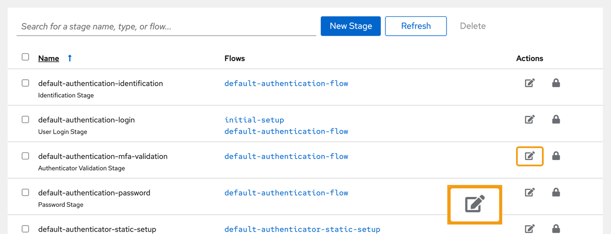
  <br><em>The MFA validation stage already exists in the stage list; the learner edits it rather than creating one. (Source: p. 5, Figure 2.5)</em>
</p>

<p align="center">
  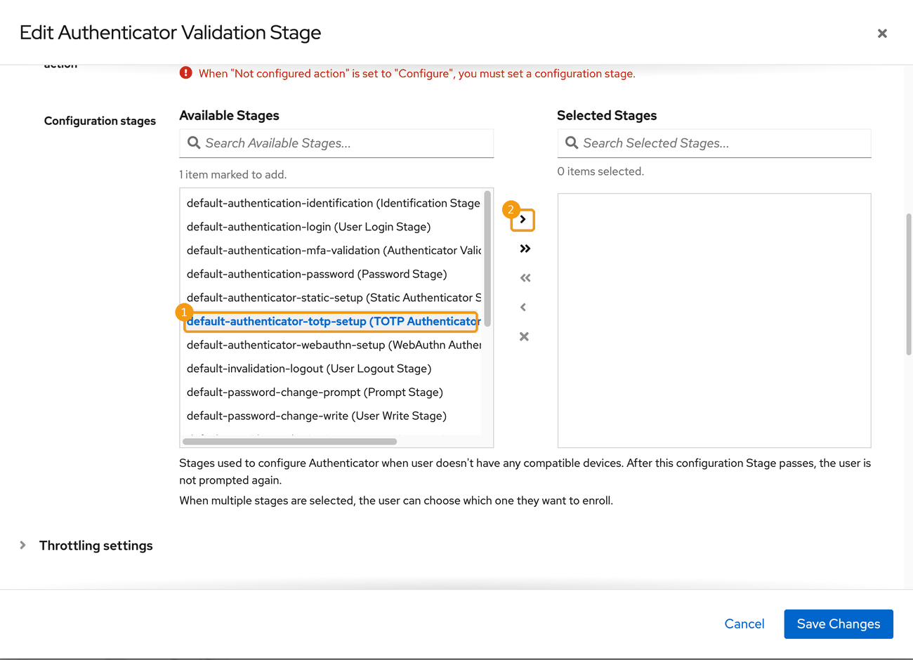
  <br><em>Selecting the TOTP setup stage and moving it across with the single arrow. (Source: p. 6, Figure 2.7)</em>
</p>

<p align="center">
  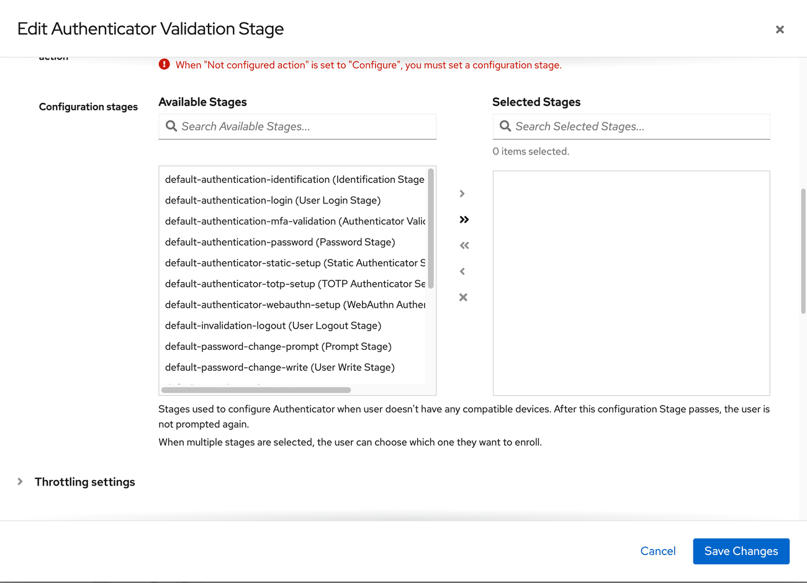
  <br><em>The error shown when no configuration stage has been selected. (Source: p. 8, Figure 2.9)</em>
</p>

</details>

> **This gates the admin account too (p. 9).** The stage sits in the login flow every account uses, including `akadmin`. On a fresh lab the admin has no authenticator, so the next admin sign-in is interrupted for TOTP enrollment. The guide tells the learner to enroll the admin and keep that authenticator entry, because lockout recovery is done from the admin console: if the admin's own device is lost, the recovery path is behind the same gate, and there is no way back in from the browser. An appropriate admin recovery path should be in place before MFA is enforced.

### Part 1, Step 3: Check the authentication flow (read-only)

This step is a **read-only check**; nothing is added (pp. 9–12). In **Flows and Stages > Flows**, the learner opens `default-authentication-flow` (titled *Welcome to authentik!*) and its **Stage Bindings** tab, and confirms four bindings:

| Order | Stage |
|---|---|
| 10 | `default-authentication-identification` |
| 20 | `default-authentication-password` |
| 30 | `default-authentication-mfa-validation` |
| 100 | `default-authentication-login` |

The order is the login sequence: identify the user, check the password, challenge for MFA, then sign in. **No additional MFA validation binding should be added.** The guide warns that a second validation stage in the same flow is the easiest way to break the lab.

<p align="center">
  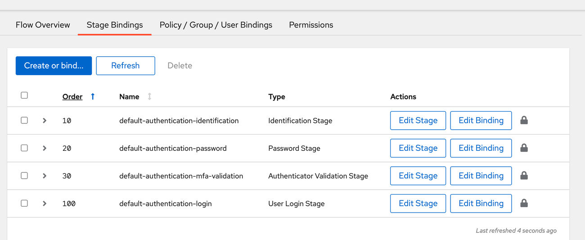
  <br><em>Four bindings: identification, password, MFA validation at order 30, then login. Nothing is added here. (Source: p. 11, Figure 2.14)</em>
</p>

<details>
<summary><strong>Supporting screenshot (1):</strong> the flows list</summary>

<p align="center">
  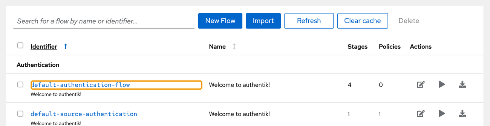
  <br><em>default-authentication-flow is the login flow every account uses. (Source: p. 10, Figure 2.12)</em>
</p>

</details>

**Conditional cleanup for an older guide version (p. 12).** This applies **only if** the learner previously followed an earlier version of the lab that created a stage called **`TOTP Validation`** and bound it at **order 40**. In that case the guide says to delete that binding and then that stage, because Authentik runs every validation stage in a flow and users would be asked for a code twice, with the old stage's settings applied on top. No other stages should be deleted.

### Part 1, Step 4: Enforced enrollment for a test user

**Set a password first (p. 12).** Accounts created by the Lab 1 sync have no password. In the admin window, **Directory > Users** > the user > **Overview** > **Recovery** > **Set password**. The password itself is chosen by the learner and is never recorded here; the password dialog (Figure 2.17) is not reproduced.

<details>
<summary><strong>Supporting screenshot (1):</strong> where Set password sits</summary>

<p align="center">
  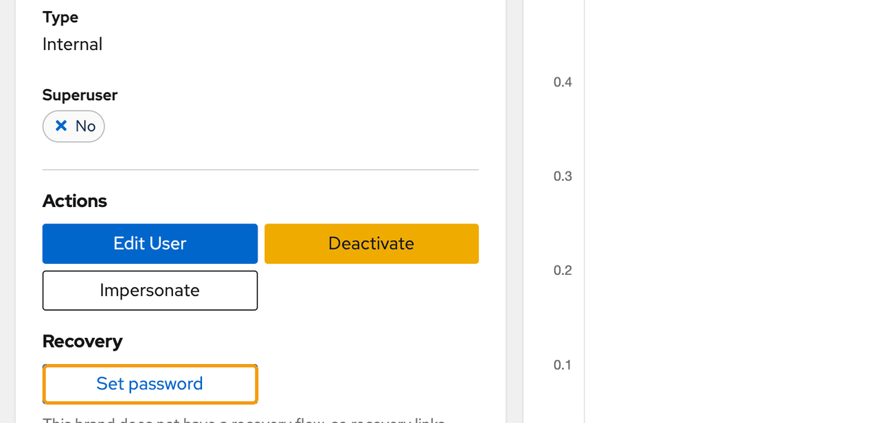
  <br><em>Set password sits under Recovery on the user's Overview tab; without it the synced account cannot sign in. (Source: p. 13, Figure 2.16)</em>
</p>

</details>

**Enrollment inside the sign-in (pp. 12–17).** The guide's sequence:

1. Open a **separate private or incognito window**, so the admin session is unaffected.
2. Go to `YOUR_AUTHENTIK_URL/if/user/` and sign in as the **test user** (not the admin), a user who has no enrolled authenticator.
3. After the password, instead of reaching the user interface, the user is stopped at a QR code. This is the existing validation stage at order 30 finding no device and handing over to the TOTP setup stage; the user did not navigate there.
4. The user scans the enrollment QR code with the authenticator app, or uses **Copy Secret** to enter the setup secret by hand. This happens privately on the user's own device.
5. The user types the **current six-digit code** into *TOTP Code* and clicks **Continue**.
6. The expected result is the signed-in user interface. Enrollment happens inside the login, not after it.

The enrollment screens (Figures 2.20 to 2.22) are excluded from this package because they are the screens that carry the QR code, setup secret and code.

**Expected result (p. 18).** The user holds a TOTP device named **TOTP Authenticator**. It appears under **Settings > Credentials** for the user and under **Directory > Users > (user) > Credentials / Tokens > MFA Authenticators** for an admin.

<p align="center">
  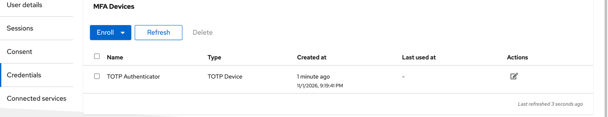
  <br><em>The user's new device, named TOTP Authenticator, in the user's own settings. (Source: p. 18, Figure 2.24)</em>
</p>

<p align="center">
  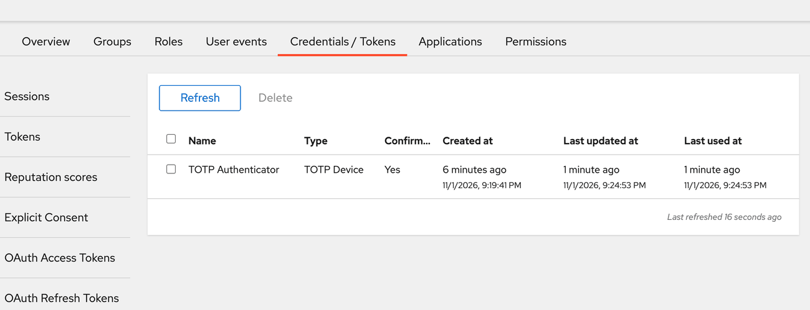
  <br><em>The same device from the admin side. The guide calls this screen the lockout recovery point. (Source: p. 18, Figure 2.25)</em>
</p>

**If the code is rejected (pp. 18–19).** Authentik answers *Code does not match*. The guide gives **clock drift** as the usual cause: a TOTP code is derived from the current time, so a device whose clock has drifted produces codes the server rejects. Its fix is to turn on automatic date and time and try the next code; the enrollment QR stays valid. Clock drift is a likely cause, not the only possible one (for example, a mistyped or expired code, or the wrong account entry in the app). The error screen (Figure 2.26) is excluded because it is an enrollment screen.

### Part 1, Step 5: Sign in again with the enrolled device

To test the ordinary challenge, the learner signs out completely (**menu under the initials > Sign out current user**), so the next sign-in is a fresh run of the authentication flow, then signs in again with the same test user (pp. 19–21). After the password, the expected behavior is a prompt for an **authentication code** with no QR code; the user enters the current code from the app and reaches the user interface.

<p align="center">
  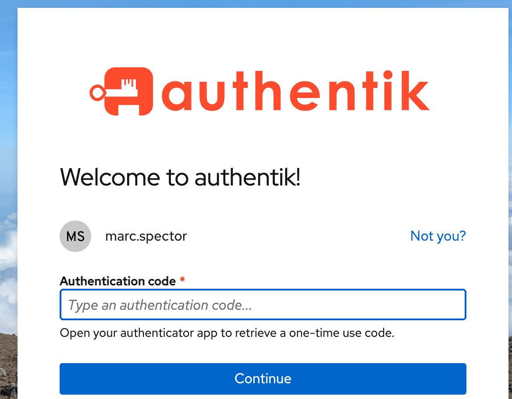
  <br><em>The ordinary challenge for an enrolled user: no QR code, just a code from the already-enrolled device. (Source: p. 20, Figure 2.28)</em>
</p>

<details>
<summary><strong>Supporting screenshots (2):</strong> signing out fully and the signed-in user interface</summary>

<p align="center">
  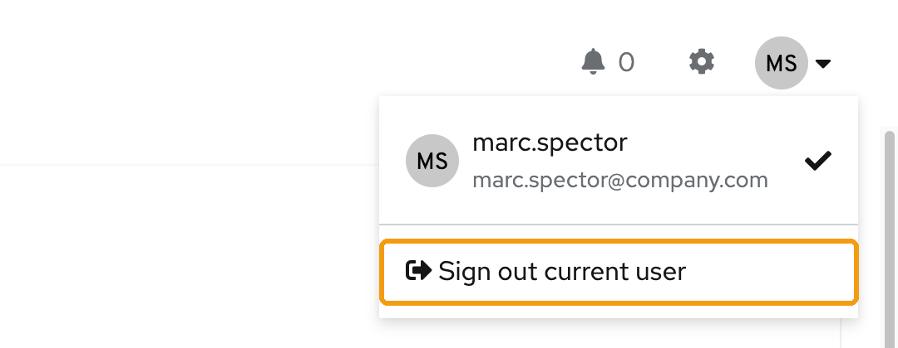
  <br><em>Signing out fully, so the next sign-in starts a fresh authentication flow. (Source: p. 20, Figure 2.27)</em>
</p>

<p align="center">
  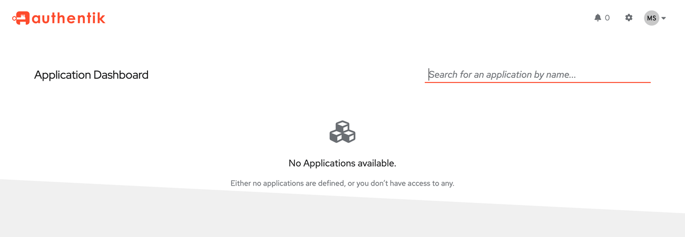
  <br><em>The signed-in user interface the guide expects after the code is accepted. (Source: p. 21, Figure 2.30)</em>
</p>

</details>

| Situation | What happens in the basic flow |
|---|---|
| First sign-in, no authenticator | Validation stage forces TOTP enrollment inside the login |
| Later fresh sign-in, enrolled device | Validation stage challenges for a code from the enrolled device |
| Existing browser session | No new authentication flow runs, so it is **not** a test of MFA; sign out fully first |

The guide's expected result is that users must provide a TOTP code after their password on every login (p. 21). That statement applies to the **basic configuration and a fresh sign-in**; the optional configurations below change it (for example, conditional MFA lets non-members skip the challenge).

### Part 2: Optional configurations

These scenarios are **optional** and separate from the basic TOTP setup. The guide recommends them only for learners with the required hardware or a specific use case. They are documented here as described by the guide; none is claimed as executed.

#### Optional scenario 1: WebAuthn (security keys and passkeys)

**Requirements (p. 22):** a physical security key (for example YubiKey or Titan Key) or a supported built-in authenticator (Windows Hello, Touch ID, Face ID), **plus HTTPS** on the Authentik instance.

For this optional scenario only, the existing `default-authenticator-webauthn-setup` stage is added to *Configuration stages* on the validation stage, **alongside** the TOTP setup stage. With more than one configuration stage, a user with no authenticator is offered a **choice**; they do not have to enroll every option.

The guide states that the lab's plain HTTP address cannot complete WebAuthn enrollment; it stops at a message that WebAuthn requires HTTPS (p. 23). WebAuthn enrollment is therefore not expected to succeed in the HTTP lab environment, and no WebAuthn result is claimed.

<p align="center">
  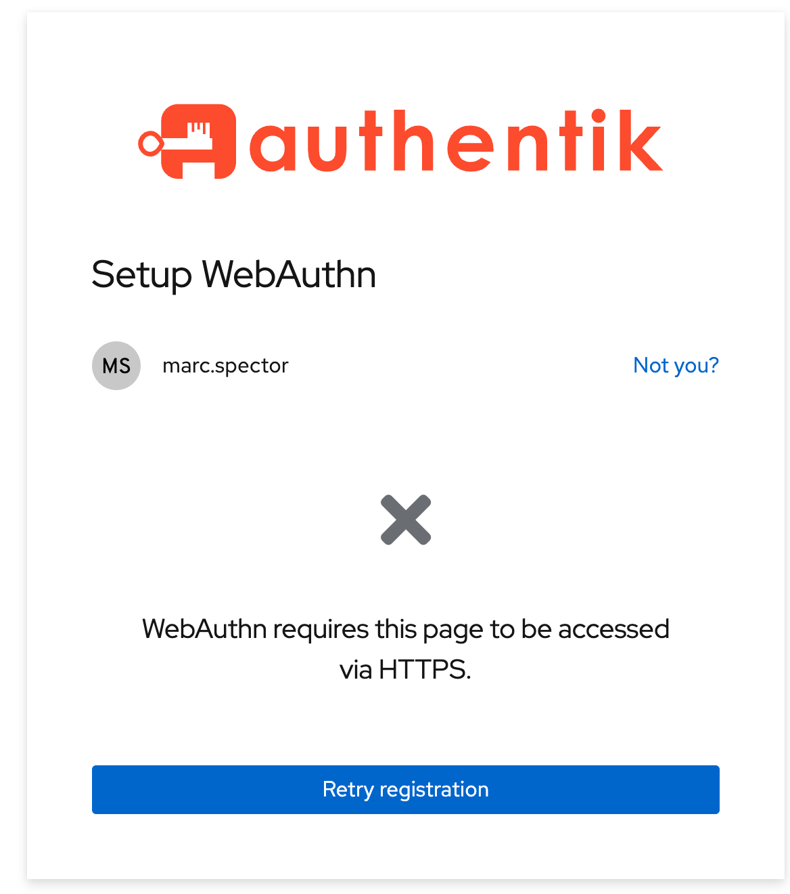
  <br><em>WebAuthn on the lab's plain HTTP address: enrollment stops because HTTPS is required. (Source: p. 23, Figure 2.32)</em>
</p>

<details>
<summary><strong>Supporting screenshot (1):</strong> two configuration stages</summary>

<p align="center">
  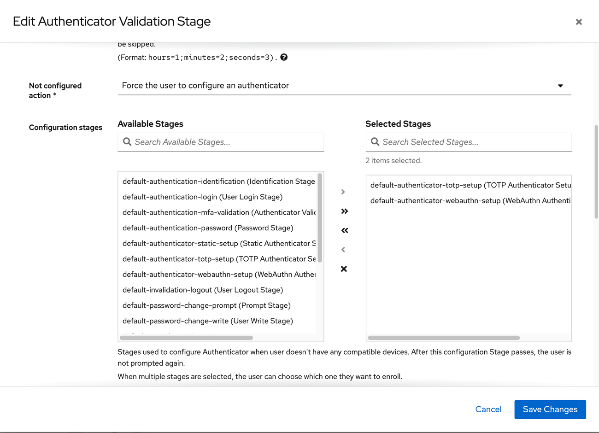
  <br><em>Two configuration stages: a new user chooses which one to enroll. (Source: p. 23, Figure 2.31)</em>
</p>

</details>

#### Optional scenario 2: Conditional MFA by group

Here MFA applies only to members of one group (pp. 24–28):

1. **Directory > Groups > New Group**, named exactly **`MFA Required Users`**. Add test users, leaving one out for comparison.
2. **Customization > Policies > New Policy > Expression Policy**, named **`mfa-required-users`**, with this expression:

```python
return ak_is_group_member(request.user, name="MFA Required Users")
```

3. In `default-authentication-flow` > **Stage Bindings**, expand the **existing order-30 binding** for `default-authentication-mfa-validation`, and use **Create or bind... > Bind an existing policy** inside that row to bind `mfa-required-users`. This is a policy on the **stage binding** inside the login flow, not an application binding.
4. **Edit Binding** on that row and set **Policy engine mode** to **ALL**. The binding already holds a policy Authentik ships, which passes for every password login; the guide explains that on **ANY** that shipped policy passes and the group restriction has no effect.
5. Test a member and a non-member. The intended outcome is that the member is still challenged and the **non-member intentionally skips MFA**.

`akadmin` is not in the group, so in this scenario the admin also skips MFA unless it is added. If admin protection is intended, the admin should be included in the group.

<p align="center">
  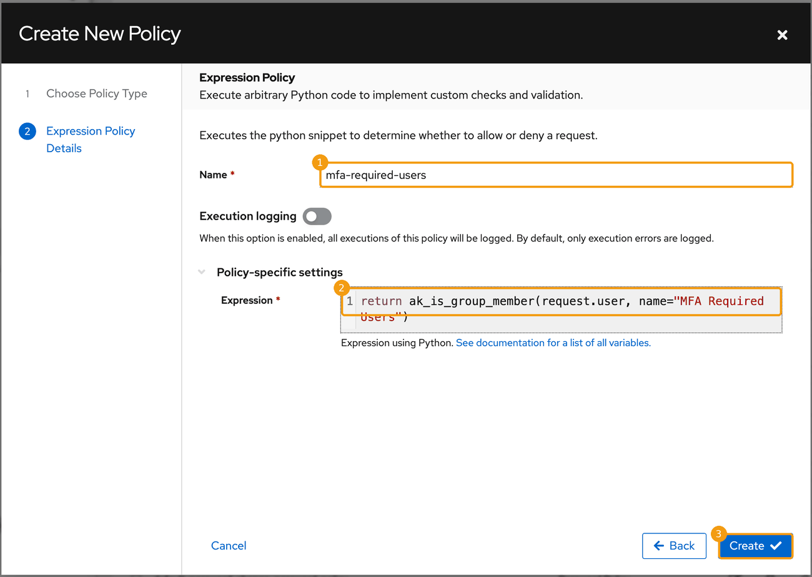
  <br><em>The expression policy, which returns true only for members of MFA Required Users. (Source: p. 26, Figure 2.38)</em>
</p>

<p align="center">
  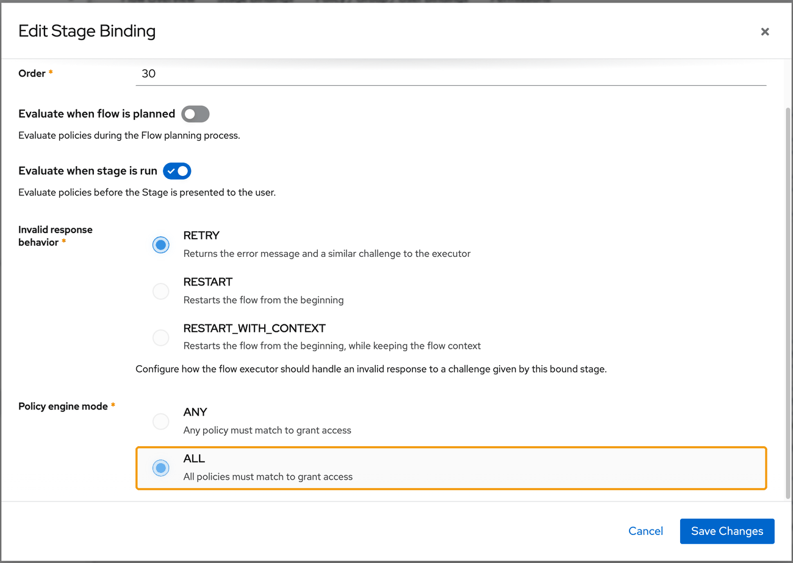
  <br><em>Policy engine mode set to ALL on the order-30 binding. On ANY, the policy already bound there passes for everyone. (Source: p. 28, Figure 2.41)</em>
</p>

<details>
<summary><strong>Supporting screenshots (3):</strong> new group, the order-30 binding and binding the policy</summary>

<p align="center">
  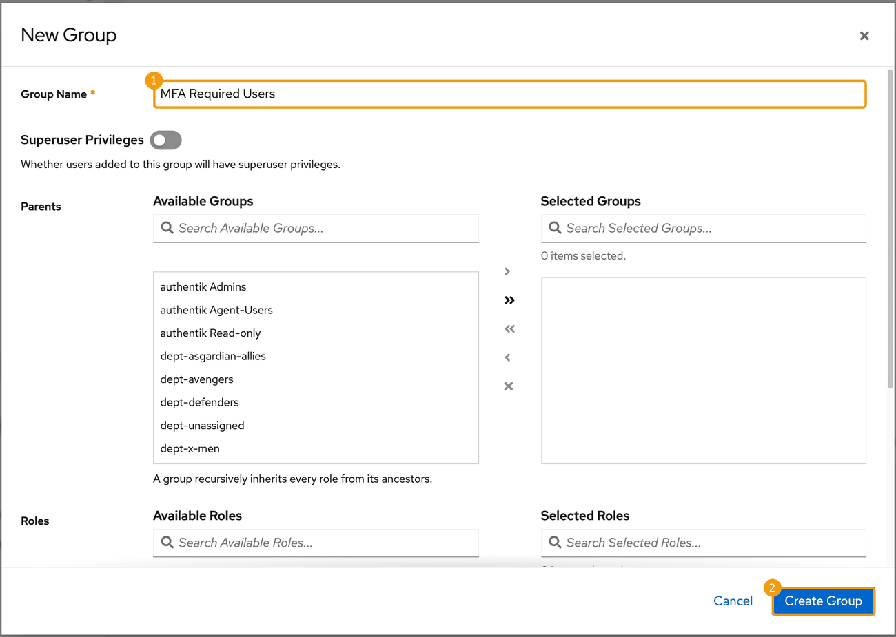
  <br><em>The group is named exactly as the policy spells it. (Source: p. 25, Figure 2.34)</em>
</p>

<p align="center">
  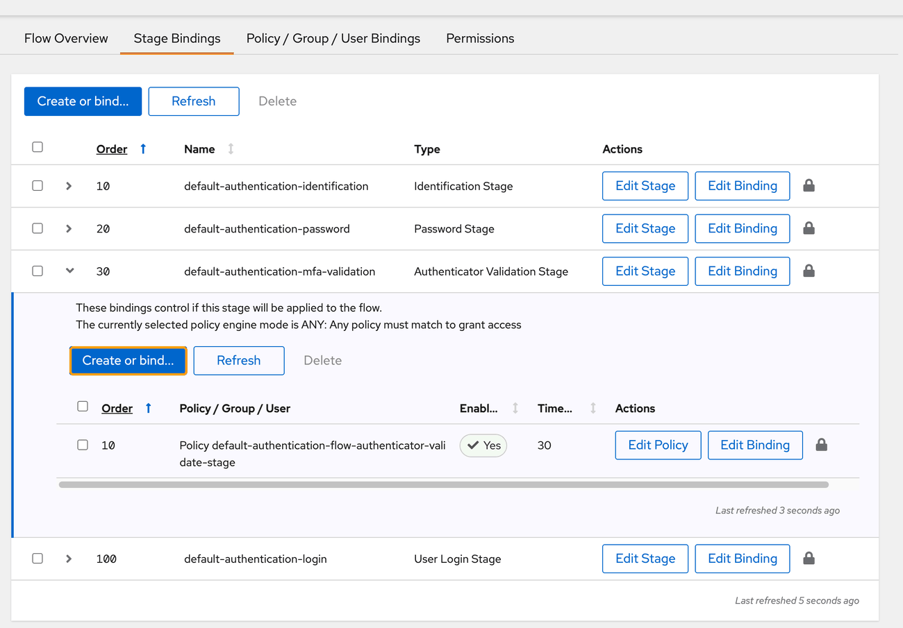
  <br><em>The order-30 binding expanded, with its own Create or bind button inside the row. (Source: p. 27, Figure 2.39)</em>
</p>

<p align="center">
  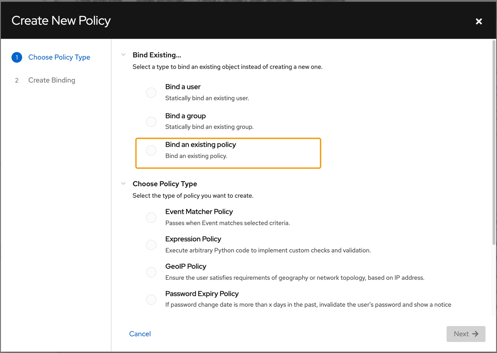
  <br><em>Binding the existing policy to the stage binding; a policy that is not bound has no effect. (Source: p. 27, Figure 2.40)</em>
</p>

</details>

#### Optional scenario 3: Backup codes

Authentik ships an existing backup-code stage, **`default-authenticator-static-setup`**, and users enroll it themselves (pp. 28–30):

1. As the user, **Settings > Credentials**, then in **MFA Devices** click **Enroll > Static tokens**.
2. The codes shown are to be saved somewhere safe. **Each code works once.**
3. The guide says to do the same as `akadmin`, because those codes are the admin's way back in if the admin's phone is lost.

Once a user holds both, the sign-in offers a choice: **Traditional authenticator** is the app, and **Recovery keys** are the backup codes.

**Do not add the static-token setup stage to the basic validation stage's Configuration stages.** The guide warns that the list is a choice, so a new user could pick backup codes instead of TOTP and end up with backup codes as their only second factor (p. 30).

Backup codes are secrets. They must be stored privately (for example in a password manager or a sealed offline record), never committed to a repository or included in portfolio evidence. The backup-code screen (Figure 2.44) is excluded from this package.

<p align="center">
  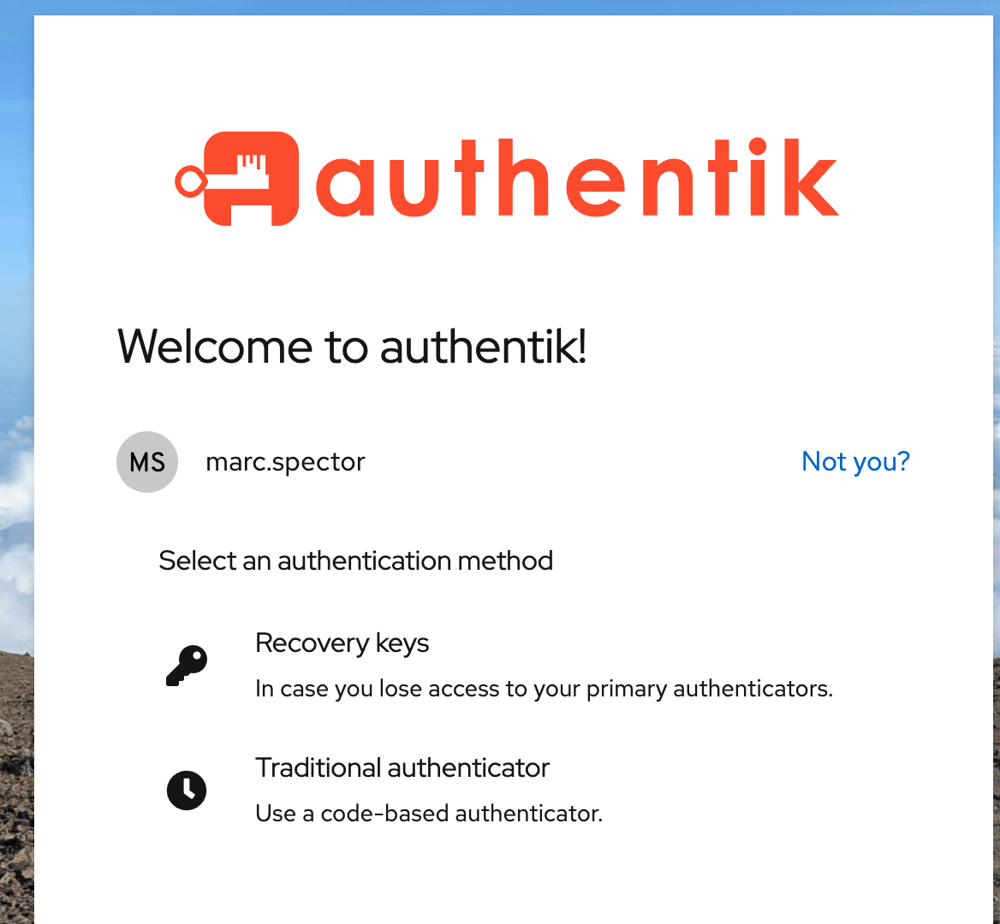
  <br><em>A user holding both factors chooses at sign-in: Traditional authenticator is the app, Recovery keys are the backup codes. (Source: p. 30, Figure 2.46)</em>
</p>

<details>
<summary><strong>Supporting screenshots (2):</strong> enrolling static tokens and the resulting device list</summary>

<p align="center">
  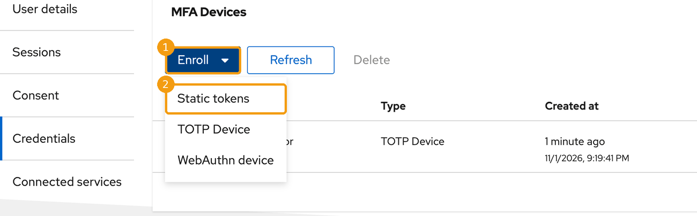
  <br><em>Each user enrolls their own backup codes from the stage Authentik already ships. (Source: p. 29, Figure 2.43)</em>
</p>

<p align="center">
  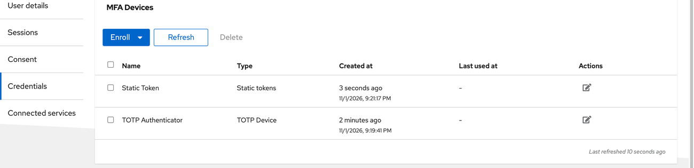
  <br><em>The user's device list with a static token as a backup alongside the TOTP device. (Source: p. 30, Figure 2.45)</em>
</p>

</details>

### Part 3: Device administration and recovery

**Admin view (p. 31):** **Directory > Users** > select the user > **Credentials / Tokens** tab > **MFA Authenticators**. Devices can be viewed and deleted.

**User view (p. 33):** on Authentik 2026.8, **Settings > Credentials**, in a panel headed **MFA Devices**, where a user can enroll a new device or remove one. According to the guide, builds up to and including 2026.2 had a separate MFA Devices tab instead; the admin view is the same in both.

<p align="center">
  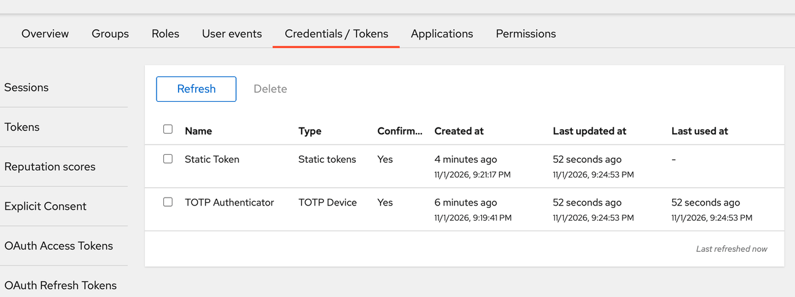
  <br><em>Each enrolled device with when it was created and last used, from the admin side. (Source: p. 32, Figure 2.48)</em>
</p>

**Lost-device recovery (p. 32).** The guide's procedure, and the conditions it depends on:

1. The admin deletes the device the user can no longer reach.
2. The user remains subject to the validation stage and its force-enrollment setting.
3. At the next qualifying sign-in, Authentik takes the password and runs TOTP enrollment again, as in Step 4.
4. The following sign-in checks that the replacement authenticator is the one challenged.

Deleting a device does not by itself guarantee re-enrollment: it depends on the user still being in scope of the validation stage with force-configure enabled (for example, a user outside the group in optional scenario 2 would simply skip MFA).

<p align="center">
  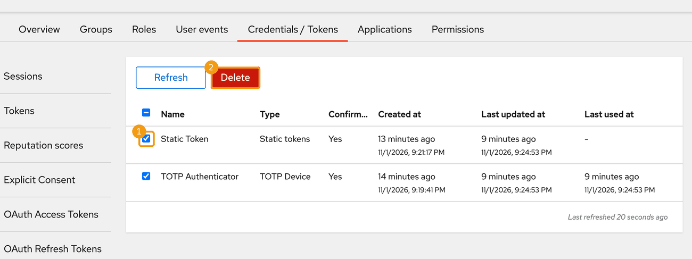
  <br><em>Selecting a lost device and deleting it; the user re-enrolls at the next sign-in. (Source: p. 32, Figure 2.49)</em>
</p>

**Recovery dependency.** Browser-based recovery requires access to the admin console. Because the admin is gated by the same stage, an admin who loses their only factor cannot use that protected console to recover themselves. The guide's mitigations are to keep the admin's own authenticator entry safe and to give the admin backup codes (optional scenario 3). The guide does not describe an emergency bypass, command-line recovery or break-glass procedure, and none is described here.

---

<a id="key-findings-results"></a>

## :mag: Key Findings / Results

No test passes, recovery outcomes or metrics are claimed. The findings below are the configuration points and expected behaviors **the guide describes**.

- **MFA was already present but not enforced.** The intended change is one setting on an existing stage, not a new stage or a new binding.
- **Accepted devices and offered enrollment are separate settings.** Device Classes controls acceptance; Configuration stages controls enrollment. Keeping only TOTP in Configuration stages keeps the basic enrollment path TOTP-only.
- **Duplicate validation stages cause double prompts.** The flow check is read-only, and cleanup applies only to the old `TOTP Validation` stage from an earlier guide version.
- **Enforcement includes the admin.** The admin must hold a working authenticator and a recovery method before MFA is relied on.
- **Fresh sign-ins are the test.** An existing session does not exercise the flow.
- **Optional scenarios change the basic behavior.** Conditional MFA intentionally lets non-members skip MFA and depends on the ALL policy engine mode; WebAuthn needs HTTPS; backup codes must stay out of the basic Configuration stages.

<details>
<summary><strong>Guide's testing checklist (p. 34) and status in this documentation</strong></summary>

| Checklist item | Status in this documentation |
|---|---|
| TOTP enrollment works for a test user | Method documented; source-illustrated; not verified |
| MFA prompt appears at login after password entry | Source-illustrated (Figure 2.28); not verified |
| TOTP authentication completes successfully | Expected result per the guide; not verified |
| Users can manage their own MFA devices | Navigation documented; source-illustrated |
| Admin can view and delete user MFA devices | Source-illustrated (Figures 2.48 and 2.49); not verified |
| Lockout recovery procedure tested (admin can remove device) | Procedure documented; not tested |

</details>

### Troubleshooting (from the guide)

| Symptom | Likely cause and fix described by the guide |
|---|---|
| Save refused with "you must set a configuration stage" | Force-configure needs a configuration stage; move `default-authenticator-totp-setup` into Selected Stages and save again |
| Users asked for a code twice | A second validation stage in the flow, typically the old `TOTP Validation` stage at order 40 from an earlier guide version; remove that binding and stage only |
| "Code does not match" | Usually clock drift on the authenticator device; enable automatic time and try the next code (other causes are possible) |
| WebAuthn enrollment stops | The lab uses plain HTTP; WebAuthn requires HTTPS |
| Group restriction has no effect | Policy engine mode left on ANY; set the order-30 binding to ALL |
| Menus look different | The guide targets Authentik 2026.8; builds up to 2026.2 had a separate MFA Devices tab. The version is shown at the bottom of the admin sidebar |

---

<a id="skills-demonstrated"></a>

## :brain: Skills Demonstrated

- Enforcing MFA enrollment in Authentik by reconfiguring an existing validation stage rather than duplicating it
- Distinguishing accepted device classes from offered enrollment stages
- Reading flow stage bindings and their order, and avoiding duplicate validation stages
- Planning admin protection and recovery before enforcing MFA on a shared login flow
- Testing enrollment, challenge and fresh-session behavior from the user's perspective
- Applying policy-based conditional MFA on a stage binding, including policy engine modes
- Managing MFA devices and backup codes from the admin and user sides
- Handling MFA secrets and evidence safely (no QR codes, seeds, codes or passwords in documentation)

---

<a id="screenshots-evidence"></a>

## :camera_with_flash: Screenshots & Evidence

The screenshots in this package are the guide author's example screenshots, selected for relevance. Essential screens are shown inline in [Implementation / Steps Performed](#implementation-steps), and supporting screens are in collapsible sections under each step, so each selected screenshot appears once.

**Excluded on purpose:**

| Figures | Reason |
|---|---|
| 2.20, 2.21, 2.22 and 2.26 | TOTP enrollment screens (QR code area, Copy Secret, code entry, error during enrollment). The source author already replaced the QR code and code with placeholders, but enrollment screens are excluded by policy |
| 2.44 | Backup-code display (codes already replaced by placeholders in the source); excluded by policy |
| 2.2, 2.17 and 2.19 | Password entry and password-setting screens; no evidence need |
| 2.29 | Code-entry screen with a populated (placeholder) code; Figure 2.28 shows the same challenge with an empty field |
| Other figures | Navigation screens, empty forms, login screens and duplicates (Figure 2.23 is identical to Figure 2.30; Figure 2.52 differs from Figure 2.24 only by a highlight) |

Each candidate screenshot was inspected individually for passwords, QR codes, setup secrets, OTP values, backup codes, tokens, session identifiers and personal information. The selected screenshots contain none of these; people shown are fictional lab accounts, and no redaction was required. PNG metadata was dropped when the screenshots were re-encoded.

The full list of selected screenshots (file, page, figure, exact original caption, dimensions, checksum and sensitivity decision) and every excluded figure with its reason are recorded in [`docs/evidence-manifest.json`](docs/evidence-manifest.json). Client questions are in [`docs/CLIENT-REVIEW.md`](docs/CLIENT-REVIEW.md).

---

<a id="real-world-relevance"></a>

## :briefcase: Real-World Relevance

- **Account takeover:** MFA is a standard control against stolen or reused passwords. Forcing enrollment at sign-in avoids a gap in which accounts exist without a second factor.
- **TOTP is not phishing-resistant:** the guide warns that a fake login page can ask for a code and relay it to the real site within the same 30-second window, and states that NIST SP 800-63B-4 does not count OTP codes as phishing-resistant. Security keys and passkeys (WebAuthn) can resist this because their cryptography is tied to the real site. This attribution is to the guide; no compliance claim is made.
- **Lockout planning:** enforcing MFA on a shared login flow without an admin recovery path can lock administrators out. The guide's best practices include documenting the lockout recovery procedure before enabling MFA and training users on what to do if they lose a device.
- **Operations:** the guide also recommends regularly auditing enrolled devices in the admin console, monitoring failed MFA attempts in the event log, and always using HTTPS in production.

---

<a id="summary"></a>

## :memo: Summary

This lab documents enforcing TOTP-based MFA in Authentik by switching on the validation stage Authentik already ships: setting its *Not configured action* to force enrollment with the TOTP setup stage, confirming the login flow's four bindings without adding a duplicate, testing enforced enrollment in a private window, and then testing the ordinary code challenge after a fresh sign-in. Optional WebAuthn, conditional MFA and backup-code scenarios are kept separate from the basic setup, and device administration and lost-device recovery are documented with their dependency on admin console access.

The intended outcome is that, in the basic configuration, users without an authenticator are enrolled during sign-in and enrolled users are challenged for a TOTP code on a fresh sign-in, while the admin retains a working authenticator and a recovery path. The screenshots and results come from the guide author's environment; personal execution by the portfolio owner has not been verified.

---

<a id="disclaimer"></a>

## :warning: Disclaimer

This project is documented for educational and portfolio purposes. The lab design, instructions and screenshots are from *Hands-On IAM Labs – Lab 2: Setting Up Multi-Factor Authentication* (V11) by Andrew, All Things Identity, and remain the property of their author. Names in the screenshots are fictional lab accounts. No passwords, enrollment QR codes, TOTP secrets, one-time codes, backup codes, server addresses or live identity data are included. No lab infrastructure was accessed or changed in preparing this documentation: the login flow was not changed, no devices were enrolled or deleted, no passwords were reset and no policies were created.

---

<p align="center">
  <strong>Created as part of a professional cybersecurity and IAM portfolio.</strong>
</p>
